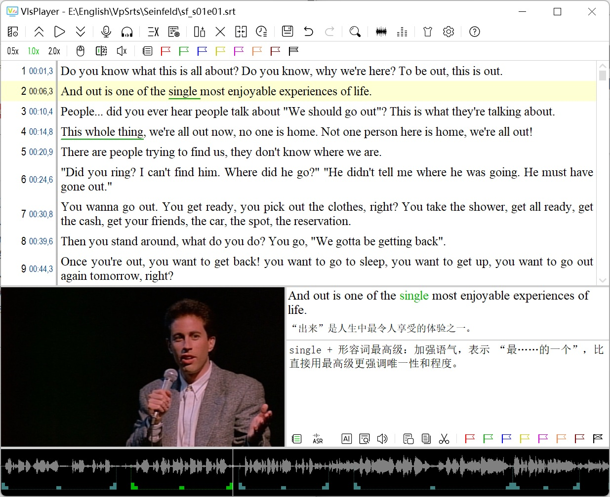
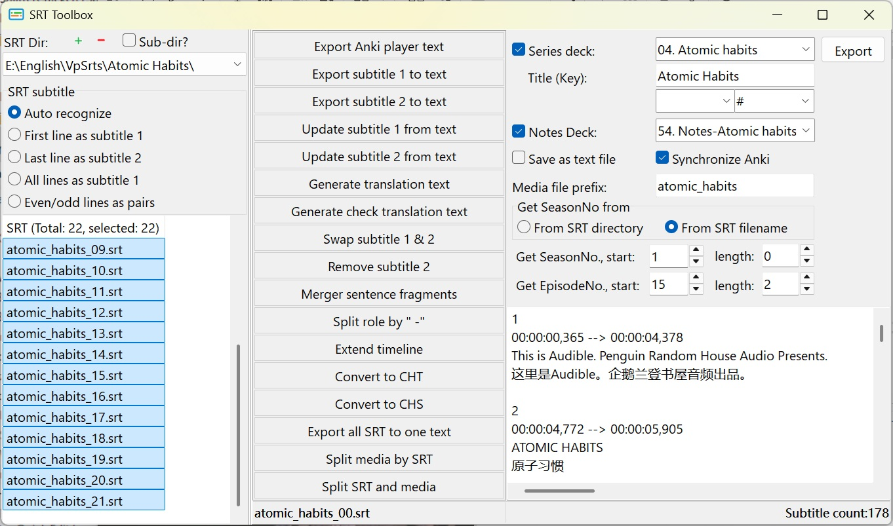
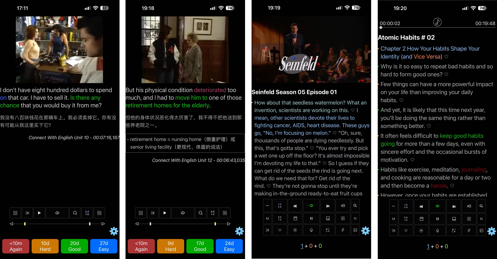

# VlsPlayer

**[English](#english) · [简体中文](#chinese)**

---

## English

> A player built for language learning.
- Goal: intensive listening, intensive reading, careful proofreading, elegance.
- Solves: rough subtitles that cannot be edited, no way to add tags or notes, inefficient workflows.

### ✨ Main Features

- 🎬 **Audio & Video Playback**: Built-in MPV / VLC dual engines, supports all media formats
- 📝 **Subtitle Editor**: Full-featured subtitle editor, an efficient productivity tool
- 🎯 **ASR Auto Recognition**: Automatically generates high-accuracy subtitles and corrects subtitle timelines
- 🔁 **Multiple Playback Modes**: Single sentence, role-play dialogue, selection loop, variable speed
- 🎙️ **Dialogue & Recording**: Simulate real conversations, record your voice, and compare with the original
- 📓 **Notes & Tags**: Multiple tags and notes for easy filtering and review
- 📤 **Anki Cards**: One-click export to Anki, supports both sentence cards and full-series cards
- 🤖 **AI Assist**: One-click sentence analysis and translation

### 📸 Screenshots

Main UI

SRT Tool

Anki Cards!

### ⬇️ Download

Download the latest release from the [Releases page](https://github.com/zhangzixin-ssp/VlsPlayer/releases):

| File | Description |
|------|-------------|
| `VlsPlayer-vX.Y.Z-Win64.zip` | Main program (extract and run) |
| `VlsPlayer-vX.Y.Z-Win32.zip` | 32-bit version (small/medium ASR models only) |

**Unzip and double-click `VlsPlayer.exe` — no installation required.**

### 📦 ASR Model Download

Model files are large and **not bundled** in the main package. On first use of ASR, the program shows the download links:

- [sherpa-onnx-nemo-parakeet-tdt-0.6b-v2-fp16](https://github.com/k2-fsa/sherpa-onnx/releases/download/asr-models/sherpa-onnx-nemo-parakeet-tdt-0.6b-v2-fp16.tar.bz2) — Recommended, highest accuracy
- [sherpa-onnx-nemo-parakeet_tdt_ctc_110m-en-36000](https://github.com/k2-fsa/sherpa-onnx/releases/download/asr-models/sherpa-onnx-nemo-parakeet_tdt_ctc_110m-en-36000.tar.bz2)
- [sherpa-onnx-nemo-parakeet_tdt_ctc_110m-en-36000-int8](https://github.com/k2-fsa/sherpa-onnx/releases/download/asr-models/sherpa-onnx-nemo-parakeet_tdt_ctc_110m-en-36000-int8.tar.bz2) — Smallest, fastest

**After downloading, extract the whole folder into the `sherpa\` directory**:

    VlsPlayer\
      └─ sherpa\
           └─ sherpa-onnx-nemo-parakeet-tdt-0.6b-v2-fp16\
                ├─ encoder.fp16.onnx
                ├─ decoder.fp16.onnx
                ├─ joiner.fp16.onnx
                └─ tokens.txt

### 🚀 Quick Start

1. Unzip the program and double-click `VlsPlayer.exe`
2. See the built-in **Help → User Guide** (`VlsPlayer.html`) for details.

### 💻 Requirements

- Windows 10 / 11 (64-bit recommended)

### 🧩 What You Need to Prepare

Everything else is bundled in the release package. You only need to prepare the following, and only if you want to use the ASR features:

| Item | Purpose | Where to get |
|------|---------|--------------|
| **ASR model** | Speech recognition | See [ASR Model Download](#-asr-model-download) above |
| **Python 3.8+** | Runtime for the ASR bridge | [python.org](https://www.python.org/downloads/) |
| `numpy`, `websockets` | Python modules | `pip install numpy websockets` |

### 📄 License

This software is released under the [MIT License](LICENSE).
Third-party components and their licenses are listed in
[`THIRD-PARTY-NOTICES.txt`](THIRD-PARTY-NOTICES.txt).

### 📬 Contact

- Email: zhangzixin.ssp@gmail.com

### 🙏 Credits

This project bundles and/or depends on the following third-party components. Sincere thanks to their authors:

- **Playback engines** — [MPV / libmpv](https://mpv.io/) (LGPL/GPL), [VLC / libvlc](https://www.videolan.org/) (LGPL/GPL), [BASS](https://www.un4seen.com/) (Un4seen)
- **ASR** — [sherpa-onnx](https://github.com/k2-fsa/sherpa-onnx) (Apache-2.0); NVIDIA Parakeet-TDT-0.6B-V2 model
- **Media** — [FFmpeg](https://ffmpeg.org/) (LGPL/GPL)

Full third-party license texts are in [`THIRD-PARTY-NOTICES.txt`](THIRD-PARTY-NOTICES.txt).

**[↑ 返回顶部 / Back to top](#vlsplayer)**

---

## 简体中文

> 一款专为语言学习设计的播放器。
- 目标：精听、精读、精校、优雅。
- 解决：粗糙且无法修改的字幕，无法做标记或笔记，低效的操作模式

### ✨ 主要功能

- 🎬 **音视频播放**：内置 MPV / VLC 双引擎，支持所有媒体格式
- 📝 **字幕编辑器**：全功能字幕编辑器，高效生产率工具
- 🎯 **ASR自动识别**：自动生成高精度字幕、自动校正字幕时间轴
- 🔁 **多种播放模式**：单句、角色对话、选区循环、变速
- 🎙️ **对话与录音**：可模拟真实对话，支持录音，对比原声
- 📓 **笔记与标记**：多种标记及笔记，方便筛选与复习
- 📤 **Anki卡片**：一键导出到Anki, 支持句子及整剧
- 🤖 **AI 辅助**：一键分析句子、翻译

### 📸 截图

主界面

SRT工具

Anki卡片!

### ⬇️ 下载

从 [Releases 页面](https://github.com/zhangzixin-ssp/VlsPlayer/releases) 下载最新版本：

| 文件 | 说明 |
|------|------|
| `VlsPlayer-vX.Y.Z-Win64.zip` | 主程序（解压即用） |
| `VlsPlayer-vX.Y.Z-Win32.zip` | 32 位版本（仅支持中小 ASR 模型） |

**解压后双击 `VlsPlayer.exe` 即可运行，无需安装。**

### 📦 ASR 模型下载

由于模型文件较大，**不包含在主程序压缩包中**。首次使用 ASR 功能时，程序会提示下载地址：

- [sherpa-onnx-nemo-parakeet-tdt-0.6b-v2-fp16](https://github.com/k2-fsa/sherpa-onnx/releases/download/asr-models/sherpa-onnx-nemo-parakeet-tdt-0.6b-v2-fp16.tar.bz2) —— 推荐，精度最高
- [sherpa-onnx-nemo-parakeet_tdt_ctc_110m-en-36000](https://github.com/k2-fsa/sherpa-onnx/releases/download/asr-models/sherpa-onnx-nemo-parakeet_tdt_ctc_110m-en-36000.tar.bz2)
- [sherpa-onnx-nemo-parakeet_tdt_ctc_110m-en-36000-int8](https://github.com/k2-fsa/sherpa-onnx/releases/download/asr-models/sherpa-onnx-nemo-parakeet_tdt_ctc_110m-en-36000-int8.tar.bz2) —— 最小，速度快

**下载后解压整个文件夹到 `sherpa\` 目录下**：

    VlsPlayer\
      └─ sherpa\
           └─ sherpa-onnx-nemo-parakeet-tdt-0.6b-v2-fp16\
                ├─ encoder.fp16.onnx
                ├─ decoder.fp16.onnx
                ├─ joiner.fp16.onnx
                └─ tokens.txt

### 🚀 快速上手

1. 解压程序，双击 `VlsPlayer.exe`
2. 详细说明见程序内置的 **帮助 → 使用说明**（`VlsPlayer.html`）。

### 💻 系统要求

- Windows 10 / 11（64 位推荐）

### 🧩 你需要自行准备的东西

其它所有组件均已包含在发布包中。**只有需要使用 ASR 功能时**，才需要准备以下两项：

| 项目 | 用途 | 获取方式 |
|------|------|----------|
| **ASR 模型** | 语音识别 | 见上方 ASR 模型下载 |
| **Python 3.8+** | ASR 桥接运行环境 | [python.org](https://www.python.org/downloads/) |
| `numpy`、`websockets` | Python 模块 | `pip install numpy websockets` |

### 📄 许可

本软件采用 [MIT 许可](LICENSE) 发布。
第三方组件及其许可详见 [`THIRD-PARTY-NOTICES.txt`](THIRD-PARTY-NOTICES.txt)。

### 📬 联系

- Email: zhangzixin.ssp@gmail.com

### 🙏 致谢

本项目打包或依赖以下第三方组件，谨向作者致以诚挚的感谢：

- **播放引擎** —— [MPV / libmpv](https://mpv.io/)（LGPL/GPL）、[VLC / libvlc](https://www.videolan.org/)（LGPL/GPL）、[BASS](https://www.un4seen.com/)（Un4seen）
- **语音识别** —— [sherpa-onnx](https://github.com/k2-fsa/sherpa-onnx)（Apache-2.0）；NVIDIA Parakeet-TDT-0.6B-V2 模型
- **媒体处理** —— [FFmpeg](https://ffmpeg.org/)（LGPL/GPL）

完整的第三方许可文本见 [`THIRD-PARTY-NOTICES.txt`](THIRD-PARTY-NOTICES.txt)。

**[↑ 返回顶部 / Back to top](#vlsplayer)**
